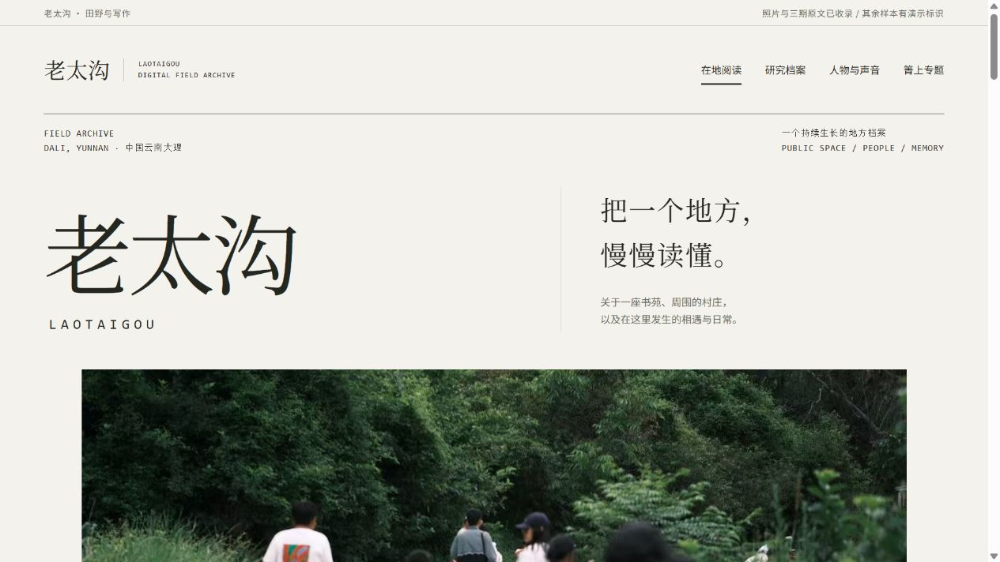

# 老太沟数字田野档案
# Laotaigou Digital Field Archive

**AI 田野调查作品集 · 展示快照 / An AI-assisted fieldwork portfolio · Showcase snapshot**



## 中文介绍

这是围绕云南大理老太沟书苑及周边村庄持续开展的田野实践作品集，将观察、写作与图像放回具体的人、物和地方关系中。当前版本把「箐上」三期联系为“从附近、旧物到水的记忆”：从重新看见附近，到旧布上的绣花，再到沿着水井、口述与地方资料追问水的变化。

原文与作品集摘要分开保存，图集保留图注与来源关系；实拍、手绘地图、产品图、题字、图文卡和生成装饰分别标注。本轮补充了 8 张实拍及 1 张题字，其中包含已有文章的同幅影像，不据此增加调查次数或项目规模。

AI 在本次制作中参与材料提取、索引、内容整理及页面代码协作；人物身份、事实、引文、署名和公开范围仍需人工判断。这里不将田野工作、全部文字或摄影笼统归为 AI 生成。早期“本期故事”演示功能已移除；其余结构样本标明 `DEMO`。当前没有实际录音、文档上传后端或已经导入的录音附件。

## English introduction

This portfolio brings together ongoing fieldwork, writing, and visual records around Laotaigou Shuyuan and its surrounding villages in Dali, Yunnan. It follows relationships between people, everyday objects, and places through three connected issues of *Qingshang*: noticing nearby life, giving embroidered fabric another everyday use, and walking through memories of water.

Source articles are stored separately from portfolio summaries. Galleries retain captions and provenance, while photographs, hand-drawn maps, product images, lettering, composite text cards, and generated decoration are identified separately. Eight supplementary photographs and one lettering image have been added. Some photographs also appear in earlier articles; their reuse does not represent additional field visits or a larger project.

Confirmed AI assistance in this production includes extraction, indexing, editorial organization, and website code collaboration. Human review remains necessary for identities, facts, quotations, attribution, and publication permissions. The fieldwork, writing, and photography are not collectively labeled AI-generated. The early “Featured Story” demo has been removed. Remaining interface examples are explicitly marked `DEMO`; no working recording/document upload backend or actual audio attachments are included.

## 三期写作 / Three connected issues

| 期 / Issue | 中文标题 | English rendering |
|---|---|---|
| 01 | 我们为什么还想在村子里，多待一会儿 | Why We Want to Stay a Little Longer in the Village |
| 02 | 把一朵花，留在日常里 | Keeping a Flower in Everyday Life |
| 03 | 沿着消失的水走 · 上篇 | Walking Along the Traces of Vanished Water · Part One |

第三期保留第 5 版；两种视觉版本属于同一期，下篇后续稿不作为已完成作品。英文标题为本展示中的译法。

Issue 03 retains version 5. Its two visual treatments count as one work; the later draft is not presented as a completed issue. English titles above are translations for this showcase.

## 下载当前展示 / Download the current showcase

完整展示的 147 个文件保存为一个可下载快照：[下载展示 ZIP](laotaigou-showcase-20261113.zip)。解压后再打开其中的首页。GitHub 仓库首页呈现双语介绍与截图；尚未启用 GitHub Pages。

The complete 147-file showcase is stored as a downloadable snapshot: [Download the showcase ZIP](laotaigou-showcase-20261113.zip). Extract it before opening the homepage. This repository presents the bilingual introduction and screenshot; GitHub Pages is not enabled.

## 解压后查看 / View after extracting

下载上述 ZIP 并解压后，在浏览器打开 `index.html` 查看首页，或打开 `qingshang-preview.html` 进入专题。保留 `prototype/`、`field-media/` 和 `qingshang/` 的目录关系，无需安装依赖。也可在解压目录运行：

Download and extract the ZIP above, then open `index.html` for the homepage or `qingshang-preview.html` for the series. Keep the accompanying folders together. No dependencies are required. Alternatively, run this command from the extracted folder:

```sh
python -m http.server 8000 --bind 127.0.0.1
```

访问 / Visit: <http://127.0.0.1:8000/>

- `prototype/`：页面源文件 / Website source files
- `field-media/`：补充展示图片与索引 / Supplementary display images and index
- `qingshang/`：三期材料、图像与来源记录 / Series materials, images, and provenance
- `docs/preview.png`：当前展示截图 / Showcase screenshot

## 权利与范围 / Rights and scope

本仓库是私有展示快照，不代表全部素材已获准对公众发布或再利用。文字、摄影、录音、绘画及题字分别归实际权利人所有；引文与第三方来源保留署名。没有为整套内容授予开源许可。对外分享前，仍需逐项核对作者、人物肖像与声音、儿童资料及再发布范围。原始录音、未脱敏转写和授权书应留在独立私人档案中。

This private showcase snapshot does not establish permission to publish or reuse every item. Text, photographs, recordings, drawings, and lettering belong to their respective rights holders; quotations and third-party sources retain attribution. No blanket open-source license is granted for the collection. Authorship, portrait and voice permissions, children’s materials, and redistribution scope require item-by-item review before wider sharing. Original recordings, unredacted transcripts, and consent records should remain in a separate private archive.
